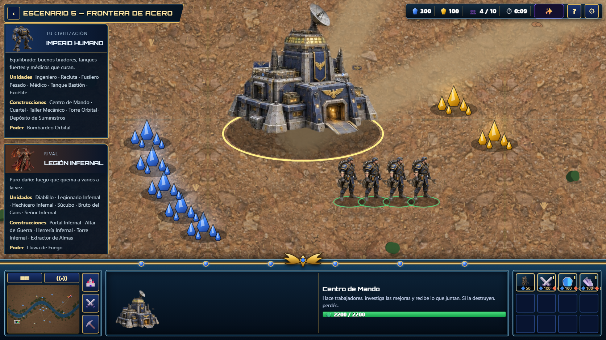
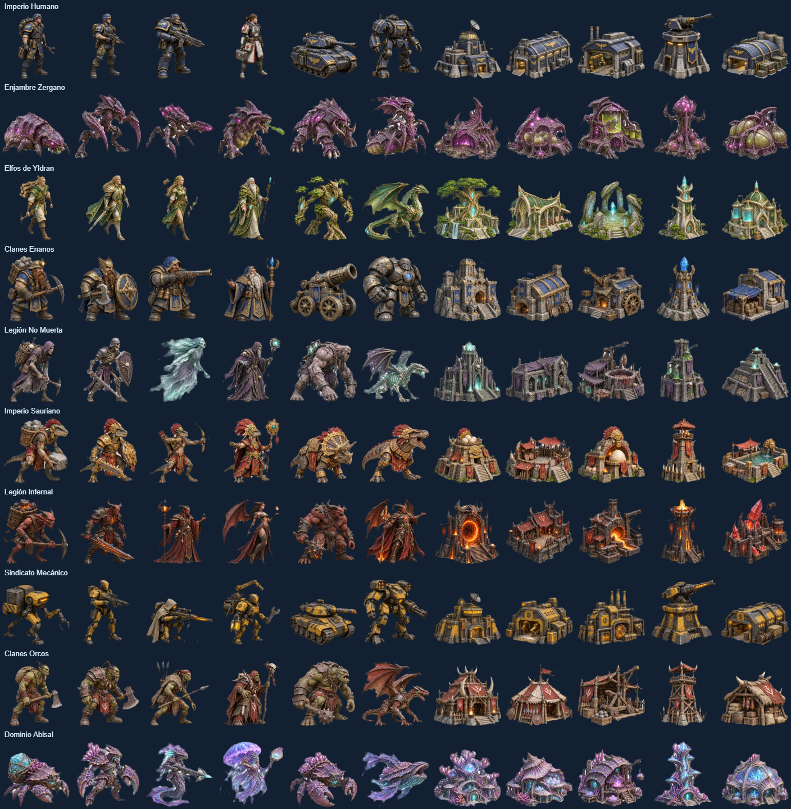

# Land of Warriors — correcciones 6

Rama: `feat/land-correcciones-6`, en ambos repositorios.

- Orbitron alojada localmente, con licencia SIL OFL, y acabado metálico del título.
- Diez tarjetas verticales de civilizaciones; rival y dificultad en ese paso.
- Cuatro dificultades: muy fácil, fácil, normal y difícil. Muy fácil retrasa las oleadas y reduce la economía y la producción de la IA.
- Tamaño elegido en Escenarios: chico 3600 × 2400; medio 6400 × 4200; grande 9000 × 6000; muy grande 12800 × 8400.
- Diez geografías independientes: fallas de ácido, archipiélago, calderas, valle de lagos, cañón, oasis, corona glaciar, humedales, claros de bosque y fosas submarinas.
- Cámara inicial 1,6×; rueda entre 1,6× y 2,8×. Arrastre izquierdo para explorar; Shift + arrastre para seleccionar; clic derecho para ordenar; minimapa para desplazarse; P para pausar.
- Menú de partida inspirado en MENU.png: información de las civilizaciones a la izquierda, recursos arriba, minimapa, selección y órdenes abajo. Los paneles se adaptan al espacio disponible.
- Textura de terreno determinista y primer plano a resolución de pantalla, con memoria acotada. Animación de marcha/ataque, balizas y vapor de edificios activos o dañados.
- Nuevas texturas de suelo para los diez biomas y once gráficos detallados por civilización (seis unidades y cinco edificios), con recortes individuales y fondo transparente.
- Un destino sin camino ya no permite atravesar agua o rocas.

## Mantener los dos repositorios iguales

Desde el repositorio donde se hizo la mejora:

```sh
node scripts/sync-land.mjs /ruta/al/otro/repositorio --check
node scripts/sync-land.mjs /ruta/al/otro/repositorio
```

El script sincroniza los archivos propios de Land, sus recursos y pruebas compartidas. Cada webapp conserva sus rutas, autenticación y resto de juegos. Las pruebas de interfaz detectan la ruta de cada proyecto a partir de su package.json. LAND_BASE permite sobrescribirla cuando sea necesario.

## Vistas de revisión




